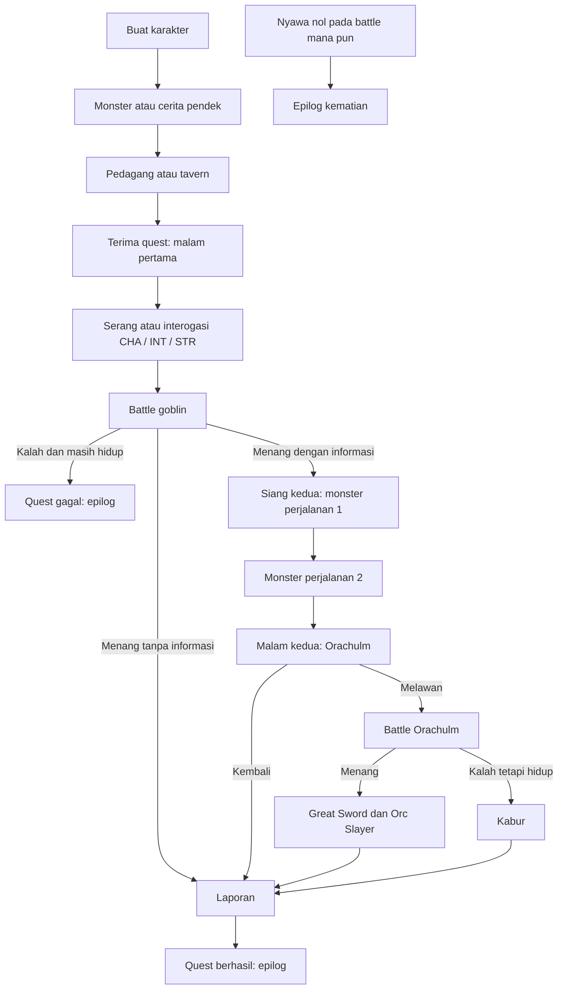

# Rancangan Program Posttest 3

Target: Python 3.14.2, standard library, sepenuhnya CLI. Dokumen ini menjelaskan implementasi posttest yang ada dalam folder ini. Tidak memakai future annotations atau berkas dependensi tambahan.

## 1. Scope

Satu petualangan di Fernley, satu quest bersambung The Missing Apple, satu cerita pendek Surat di Jembatan, encounter monster, pedagang, dan tavern. Petualangan berakhir saat quest selesai/gagal atau nyawa habis. Tidak ada save/load.

Lima poin stat diberikan pada setiap kenaikan level. Alokasi satu poin menaikkan satu stat sebanyak satu. Poin boleh disimpan untuk digunakan sebelum battle berikutnya.

Angka implementasi awal: tiga nyawa maksimum, 100 gold, 100 HP combat, kebutuhan EXP 20 × level, damage minimum satu, biaya tavern 25. Rincian konfigurasi lihat content/balance.py; identitas dan reward monster/item mengikuti katalog serta constructor item.

## 2. Struktur Folder dan File

Struktur lengkap yang relevan ada dalam tabel berikut. Setiap direktori package code juga memiliki __init__.py kosong. File ini menandai package dan tidak menjalankan logika.

| File dalam code/ | Tanggung jawab |
|---|---|
| main.py | Driver terminal: membuat sesi, menerima perintah, menampilkan kotak, dan menangani input salah/EOF. |
| cli/console.py | render_box(), show_box(), describe_options(). Tidak menyimpan aturan quest. |
| core/enums.py | EquipmentSlot, FlowPhase, QuestStatus, RunStatus. |
| core/models.py | Choice, ConditionalChoice, EventResult, BattleResult, EndingResult. |
| core/game_session.py | Aksi sesi, reward battle, kehilangan nyawa, loot penuh, dan terminal permainan. |
| core/event_director.py | Urutan event, penghitung perjalanan, hari dan fase narasi. |
| characters/character.py | Nama, Stats, TraitManager, get_info(). |
| characters/player.py | Nyawa, gold, EXP, level, alokasi poin, inventory, equipment, reputasi. |
| characters/monster.py | Statistik, rarity, tipe, HP battle, dan reward monster. |
| characters/combatant.py | HP sementara dan status seorang peserta battle. |
| characters/classes/profession.py | Paket bonus stat awal profesi. |
| combat/battle.py | Giliran, damage, pemrosesan status, dan hasil battle satu lawan satu. |
| inventory/inventory.py | Sepuluh slot; tambah, hapus, pindah, validasi indeks, dan jumlah barang. |
| equipment/equipment.py | Tujuh slot, pergantian item, konflik dua tangan dan trait. |
| items/item.py | Nama, ID, harga, deskripsi, representasi teks. |
| items/equippable_item.py | allowed_slots, traits, occupied_slots, kompatibilitas slot. |
| items/weapon.py | Weapon, CorosionDagger, VenomousAxe, GreatSword. |
| items/armor.py | Armor, CorosionSpikeArmor, GiantArmor. |
| items/shield.py | Shield untuk off hand. |
| items/accessory.py | Accessory untuk back. |
| items/consumable.py | Berkas kosong dari baseline; consumable bukan fitur yang diimplementasikan. |
| events/event.py | ABC Event: kontrak pilihan/resolusi dan validasi konkret bersama. |
| events/monster_event.py | Encounter monster mandiri. |
| events/merchant_event.py | Transaksi beli/jual dan pilihan pergi. |
| events/tavern_event.py | Pulihkan satu nyawa atau pergi. |
| events/story_event.py | StoryNode dan StoryEvent berbasis data pilihan serta handler. |
| story/quest.py | Status dasar quest beserta transisinya. |
| story/missing_apple.py | Seluruh cabang goblin, Orachulm, dan laporan. |
| content/balance.py | Validasi integer, konfigurasi umum dan fungsi damage/cek/EXP/harga jual. |
| content/catalog.py | Factory karakter, profesi, monster, dan stok baru untuk setiap sesi. |
| content/short_stories.py | Naskah dan konsekuensi Surat di Jembatan. |
| content/endings.py | Judul dan narasi enam penutup. |
| utils/stats.py | Lima atribut dan penambahan bonus. |
| utils/traits/trait.py | Metadata dan hook dasar Trait. |
| utils/traits/trait_entry.py | Stack tervalidasi suatu trait. |
| utils/traits/trait_manager.py | Perubahan stack, hook serangan dan reward. |
| utils/traits/stats_trait.py | StatsTrait dan Strong. |
| utils/traits/battle_trait.py | BattleTrait, Toxin, PoisonStatus. |
| utils/traits/resource_trait.py | ResourceTrait dan LuckiestAdventurer. |
| testing/testing.py | Peluncur unittest. |
| testing/posttest_demo.py | Bukti ABC, loop polimorfisme, duck typing, magic method, relasi, dan poin level. |

| File lain | Fungsi |
|---|---|
| tests/test_battle.py | Giliran, status, HP, RNG, hasil battle sekali pakai. |
| tests/test_cli.py | Eksekusi terminal nyata, input salah, bentuk kotak, rute pendek dan Orc Slayer. |
| tests/test_economy_progression.py | Beli/jual, tavern, EXP, saldo poin dan alokasi. |
| tests/test_equipment.py | Dua tangan, ruang inventory dan kegagalan atomik. |
| tests/test_game_routes.py | Semua penutup, interogasi, event awal/perjalanan, loot penuh. |
| tests/test_posttest.py | Kontrak ABC, validasi bersama dan duck typing. |
| docs/uml_class_diagram.mmd | Sumber diagram class untuk diekspor menjadi PNG. |
| docs/evidence/*.txt | Bukti output dari program yang benar-benar dijalankan. |
| images/README.md | Nama gambar dan petunjuk screenshot/export yang harus dibuat pengguna. |
| README.md | Laporan posttest dan cara menjalankan. |

## 3. Class dan Atribut Utama

| Class | Atribut | Method utama |
|---|---|---|
| GameSession | player, rng, director, quest, status, active_event, active_battle, ending, _pending_result, _pending_items, _completed_events | start, choose, step_battle, finish_run, allocate_points, equip, unequip |
| EventDirector | phase, completed_event_count, travel_events_completed, day, time_phase | create_next_event, record_event_completion |
| Quest | quest_id, name, description, deadline_days, _status, stage | start, complete, fail |
| MissingAppleQuest | knows_orachulm, orachulm_outcome; atribut Quest | create_goblin_event, create_orachulm_event, create_report_event |
| Event (ABC) | event_id, title, description, _completed | get_choices dan resolve abstrak; validate_choice konkret |
| MonsterEvent | monster, _battle_started | get_choices, resolve, on_battle_finished |
| MerchantEvent | stock | get_choices, resolve; transaksi internal _buy dan _sell |
| TavernEvent | rest_cost | get_choices, resolve |
| StoryEvent | nodes, current_node_id, battle_handler, _battle_started | get_info, get_choices, resolve, on_battle_finished |
| StoryNode | node_id, text, choices, actions | Objek data satu situasi |
| Character | _name, _stats, __trait_manager | name/stats/trait_manager property, get_info |
| Player | max_lives, _lives, level, _experience, _stat_points, _gold, profession, inventory, equipment, reputation | lose_life, recover_life, gain_gold, spend_gold, gain_experience, allocate_stat_points, equip_from_inventory |
| Monster | rarity, monster_type, exp_reward, gold_reward, max_health | get_info |
| Combatant | owner, max_health, __health, statuses | attack, take_damage, process_statuses, add_status, is_alive |
| Battle | player, enemy, rng, attacker, target, _result | step, start, get_result, finished property |
| Stats | strength, agility, defense, intelligence, charisma | add, __str__ |
| Profession | name, stats | __init__ |
| Inventory | max_item, items | add_item, remove_item, get_item, move_item, __len__ |
| Equipment | head, chest, back, legs, boots, main_hand, off_hand | equip_from_inventory, unequip_to_inventory, get_equipped |
| Item | item_id, name, price, description | __str__ |
| EquippableItem | allowed_slots, traits | can_use_slot, occupied_slots property |
| Weapon | two_handed | occupied_slots override |
| Armor / Shield / Accessory | Data umum EquippableItem dengan konfigurasi slot | Constructor khusus |
| Trait | __name, description, icon, __max_stack | get_effect, on_add, on_remove |
| TraitEntry | trait, __stack | increase_stack, decrease_stack |
| TraitManager | traits | change_traits, add_trait, remove_trait, trigger_attack, trigger_reward |
| StatsTrait / Strong | target, __value / konfigurasi strength | get_effect, on_add, on_remove |
| BattleTrait / Toxin | chance / damage_percent, duration, max_duration | on_attack, get_effect |
| PoisonStatus | duration, max_duration, damage_percent | on_turn, is_active, extend_duration |
| ResourceTrait / LuckiestAdventurer | base_effect | get_effect, apply, on_reward |
| Choice | choice_id, label, enabled, disabled_reason | describe |
| ConditionalChoice | choice_id, label, required_stat, difficulty, enabled, disabled_reason | describe |
| EventResult | messages, completed, outcome_id, battle_request, granted_items, ending_id | Objek hasil aksi |
| BattleResult | winner, loser | Objek hasil final battle |
| EndingResult | ending_id, title, text, remaining_lives, level, gold, quest_status, reputation | Ringkasan akhir |

## 4. Diagram Alur

Diagram ini meringkas rute yang masih hidup. Pada event awal maupun perjalanan, kalah berarti nyawa berkurang satu; jika masih hidup event selesai dan pemain lanjut. Nyawa nol selalu mengambil prioritas terminal sebelum event berikutnya.

Penerimaan quest, malam pertama, dan kelanjutan setelah dua encounter bersifat pasti. Yang diundi adalah jenis event awal dan monster dari pool perjalanan. Satu pilihan dialog bukan satu event baru.

Hari dan fase mengikuti adegan; tenggat tiga hari adalah konteks cerita, bukan timer yang terus berjalan saat pengguna membaca.

## 5. Siklus Battle

1. Event meminta battle dengan objek Monster.
2. GameSession membuat dua Combatant baru: HP penuh dan status kosong.
3. Battle menentukan giliran melalui agility; seri memberi giliran pertama kepada pemain.
4. step() memproses status, memeriksa kematian, menyerang, memeriksa target, memicu trait, lalu mengganti giliran.
5. Ketika hasil tersedia, GameSession mengonsumsinya sekali dan membersihkan active_battle.
6. Kemenangan memberi reward monster dan memicu hook reward. Kekalahan mengurangi satu nyawa.
7. Jika nyawa nol, buat ending DEAD. Jika hidup, panggil event.on_battle_finished() untuk akibat cerita.
8. Hanya event yang selesai menaikkan penghitung event. Dua monster perjalanan tidak mengubah status quest.

CLI menampilkan hasil battle dalam kotak. Class Battle tidak mencetak output dan tidak memanggil input.

## 6. Aturan Ekonomi dan Equipment

Beli memeriksa stok, gold, dan kapasitas sebelum memindahkan item. Jual hanya mengambil item dari inventory, bukan langsung dari slot terpasang. Equipment harus dilepas sebelum dijual.

Tavern memulihkan satu nyawa dengan biaya 25 gold, lalu kunjungan selesai. Nyawa penuh atau gold kurang mengunci pilihan istirahat; pilihan pergi tetap tersedia.

Equipment memakai tujuh atribut slot yang nilainya berasal dari EquipmentSlot. Item menjelaskan allowed_slots dan occupied_slots; Equipment mengelola posisi aktif. Weapon dua tangan disimpan sekali pada main_hand dan memblokir off_hand, sehingga trait tidak dihitung dua kali.

Ruang penggantian menghitung slot yang dibebaskan oleh item baru. Semua perubahan stack divalidasi sebelum equipment/inventory diubah. Dengan trait bawaan proyek, hook perubahan adalah penyesuaian stat deterministik. Penambahan hook pihak lain yang bisa gagal akan memerlukan mekanisme rollback tambahan.

Jika inventory penuh ketika mendapat Great Sword, pemain memilih membuang satu barang inventory atau meninggalkan hadiah. Reputasi dan keberhasilan quest tidak dibatalkan karena menolak senjata.

## 7. Pemetaan Posttest

| Syarat | Implementasi dan bukti |
|---|---|
| Asosiasi | Combatant.attack(target); hanya menggunakan parameter target. |
| Agregasi | Inventory menampung Item yang dibuat dari luar dan dapat dipindahkan. |
| Komposisi | Player membuat Inventory/Equipment; Character membuat TraitManager. |
| ABC + minimal dua abstract method | Event.get_choices dan Event.resolve. |
| Minimal dua subclass implementasi lengkap | Empat subclass Event mengimplementasikan keduanya. |
| Method konkret bersama | Event.validate_choice dipakai oleh resolve setiap subclass. |
| Bukti tidak dapat diinstansiasi | posttest_demo.py menangkap TypeError; test_posttest juga memeriksa subclass yang belum lengkap. |
| super dan atribut unik | Constructor semua event memanggil super, kemudian menambahkan monster/stock/rest_cost/nodes. |
| Protected/private | _completed, _lives, _stat_points, __health, __stack. |
| Overriding melalui satu loop | demonstrate_polymorphism pada posttest_demo.py. |
| Duck typing dua class tanpa hubungan inheritance | Choice dan ConditionalChoice memiliki describe; describe_options menerima keduanya. |
| Magic method | Inventory.__len__, Item.__str__, Stats.__str__ digunakan saat bermain. |
| Hindari rantai tipe | Perilaku event melalui method; slot melalui kontrak item. |
| SOLID opsional | SRP pada pemisahan battle/event/tampilan; OCP pada kontrak Event dan occupied_slots. |

Diagram class lengkap untuk laporan berada di uml_class_diagram.mmd. Gambar PNG dan screenshot sengaja menunggu pengguna; nama serta petunjuknya ada dalam images/README.md.

## 8. Enam Penutup

| ID | Kondisi |
|---|---|
| DEAD | Nyawa nol di battle mana pun. |
| APPLE_FAILED | Kalah goblin dan masih hidup. |
| APPLE_GOBLIN_RESOLVED | Menang goblin tanpa informasi dan melapor. |
| APPLE_ORC_REPORTED | Menemukan Orachulm dan kembali melapor tanpa battle. |
| APPLE_ORC_ESCAPED | Kalah Orachulm, masih hidup, kabur dan melapor. |
| APPLE_ORC_SLAYER | Menang Orachulm, menangani hadiah, dan melapor. |

## 9. Status Verifikasi

Gunakan python -m unittest discover -s tests -v untuk menjalankan seluruh tes. Beberapa tes rute memakai RNG tetap dan statistik ekstrem agar kemenangan/kekalahan tertentu bisa diverifikasi; ini tidak mengubah balancing permainan normal.

test_cli.py juga menjalankan program sebagai subprocess dengan input terminal nyata dan balancing asli. Bukti output disimpan di docs/evidence dan dapat digunakan sebagai panduan sebelum mengambil screenshot.
